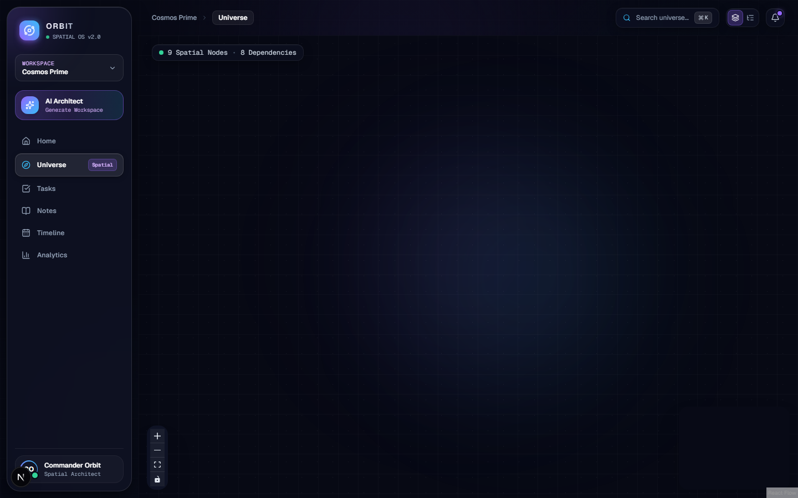
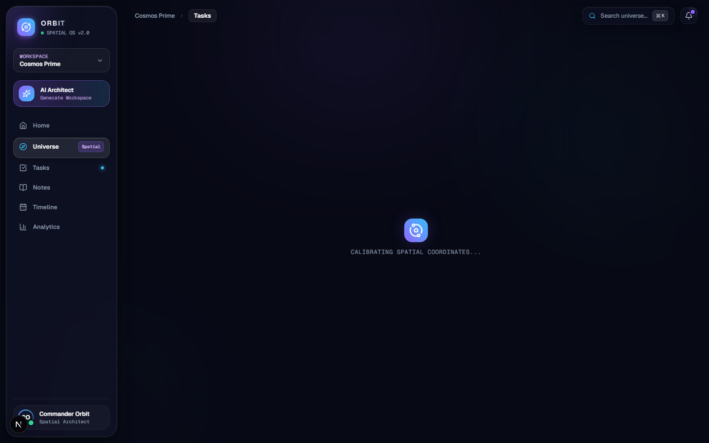
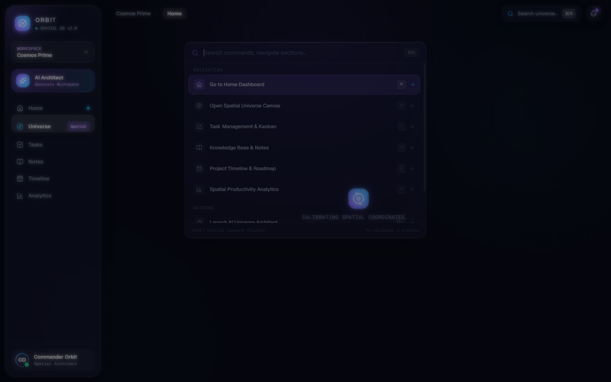
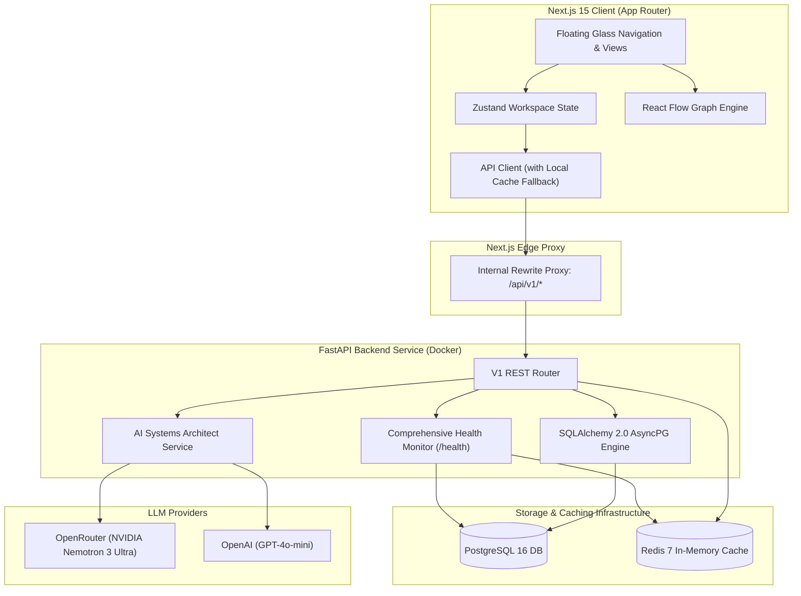

<div align="center">

# 🪐 ORBIT — Spatial Productivity Operating System

**Midnight Glass × Spatial Computing × Aurora Lighting**

*An AI-powered spatial operating system that unifies roadmaps, task execution, knowledge graphs, and autonomous architecture synthesis into an immersive visionOS-inspired canvas.*

[](https://nextjs.org/)
[](https://react.dev/)
[](https://fastapi.tiangolo.com/)
[](https://python.org/)
[](https://postgresql.org/)
[](https://redis.io/)
[](https://tailwindcss.com/)
[](https://render.com/)

[Overview](#-overview) • [Screenshots](#-interface-gallery) • [Architecture](#-system-architecture) • [Design System](#-spatial-design-system) • [Quickstart](#-quickstart-guide) • [Docker & Render](#-cloud-deployment--docker) • [CI/CD](#-cicd-pipeline) • [API Docs](#-api-reference)

---

</div>

## 🌌 Overview

**ORBIT** transforms fragmented productivity tools into a continuous, reactive spatial workspace. Combining visionOS liquid glass aesthetics with Linear-grade speed and Raycast-style keyboard fluidity, ORBIT empowers teams and engineers to plan, visualize, and execute complex roadmaps.

### Core Highlights
* 🔮 **Spatial Universe Canvas**: High-performance React Flow graph canvas connecting goals, projects, tasks, and notes with interactive force-directed coordinates and glowing dependency links.
* 📊 **Asymmetric Bento Dashboard**: Personalized hero command deck, live throughput KPI telemetry, SVG task velocity sparkline, and real-time universe preview.
* 🗂️ **Floating Glass Kanban**: Low-friction task management across *Todo*, *In Progress*, *Review*, and *Completed* lanes with instant status transitions.
* 📝 **Split-Pane Knowledge Workspace**: Distraction-free markdown editor with live reading analytics and autosave state synchronization.
* ⚡ **Raycast Command Palette (`Ctrl+K` / `⌘K`)**: Instant search, arrow-key navigation, and workspace actions accessible from anywhere.
* 🤖 **OpenRouter AI Systems Architect**: Autonomous project & milestone synthesis powered by advanced LLMs (`nvidia/nemotron-3-ultra` & OpenAI models).

---

## 📸 Interface Gallery

### 1. Home Dashboard (Asymmetric Bento Grid)
*Personalized greeting, live productivity throughput, interactive universe preview, and active project telemetry.*


---

### 2. Spatial Universe Canvas
*Signature 2D/3D spatial coordinate mesh with custom frosted nodes, luminous handles, minimap, and bi-directional edges.*


---

### 3. Floating Glass Tasks Kanban
*Fluid workflow management with inline task creation, priority filters, and project tags.*


---

### 4. Split-Pane Knowledge Workspace
*Focused writing environment with markdown toolbars, word counts, and autosave feedback.*


---

### 5. Timeline & Spatial Roadmap
*Gantt milestone tracking and progress rings synchronized to workspace entities.*


---

### 6. Raycast-Style Command Palette (`Ctrl+K`)
*Universal keyboard-driven navigation, instant search, and fast execution.*


---

## 🏛️ System Architecture



---

## 🎨 Spatial Design System

ORBIT is built upon a cohesive design token architecture defined in `packages/design-tokens` and configured with Tailwind CSS:

| Token | Hex / Value | Purpose |
|---|---|---|
| **Background** | `#070914` | Deep atmospheric midnight space canvas |
| **Primary Surface** | `#101426` | Subtle glass foundation for rails & panels |
| **Elevated Surface** | `#171B32` | Elevated glass for modals, inspectors, and command palette |
| **Violet Accent** | `#9366FF` | Primary brand accent and orbital highlight |
| **Electric Blue** | `#38BDF8` | Active navigation links and progress states |
| **Cyan Accent** | `#22D3EE` | Secondary interactive indicators and subtle glow |
| **Emerald Accent** | `#34D399` | Completion states and operational health |

### Glass Elevation Hierarchy
* **`.glass-subtle`**: Translucent borders (`rgba(255,255,255,0.08)`), minimal backdrop blur. Used in navigation buttons and pill badges.
* **`.glass-standard`**: Card surfaces with ambient top specular reflection, `backdrop-blur-xl`, and soft depth shadows.
* **`.glass-elevated`**: Maximum elevation with luminous border highlights, designed for modals, context menus, and docks.

---

## 🚀 Quickstart Guide

### Prerequisites
* **Node.js**: `v20.x` or higher
* **pnpm**: `v9.x`
* **Python**: `v3.12` or higher
* **Docker & Docker Compose**: For containerized database, cache, and API

---

### Option A: Complete Docker Compose (Recommended)

Start PostgreSQL, Redis, and the FastAPI backend in one command from the project root:

```bash
# 1. Clone repository
git clone https://github.com/your-username/orbit.git
cd orbit

# 2. Configure environment
cp .env.example .env

# 3. Start containers
docker compose up --build -d

# 4. Start Next.js frontend
pnpm install
pnpm --filter @orbit/web dev
```

* Frontend: [http://localhost:3000](http://localhost:3000)
* Backend API: [http://localhost:8000](http://localhost:8000)
* Interactive Swagger Docs: [http://localhost:8000/docs](http://localhost:8000/docs)
* Health Status: [http://localhost:8000/health](http://localhost:8000/health)

---

### Option B: Local Native Development

#### 1. Start Infrastructure Services
```bash
docker compose up postgres redis -d
```

#### 2. Start Backend API
```bash
cd apps/api

# Create & activate virtualenv
python -m venv .venv
# On Windows:
.\.venv\Scripts\Activate.ps1
# On Linux/macOS:
source .venv/bin/activate

# Install dependencies & run uvicorn
pip install -r requirements.txt
uvicorn app.main:app --host 127.0.0.1 --port 8000 --reload
```

#### 3. Start Frontend Dashboard
```bash
# In another terminal from repository root:
pnpm install
pnpm --filter @orbit/web dev
```

---

## ☁️ Cloud Deployment & Docker

### 1-Click Deployment on Render (`render.yaml`)

This repository includes a production-ready `render.yaml` Blueprint:

1. Push your repository to GitHub or GitLab.
2. Go to the [Render Dashboard](https://dashboard.render.com).
3. Select **New +** → **Blueprint**.
4. Link your repository. Render will automatically provision:
   * **`orbit-postgres`**: Managed PostgreSQL 16 database.
   * **`orbit-redis`**: Private Redis 7 key-value cache.
   * **`orbit-api`**: Containerized FastAPI backend with `/health` monitor.
   * **`orbit-web`**: Next.js 15 production web service.
5. Provide your `OPENROUTER_API_KEY` when prompted.

---

## 🔁 CI/CD Pipeline

Continuous Integration and Continuous Deployment workflows are configured under `.github/workflows/`:

```
.github/workflows/
├── ci.yml    # Linting, testing, and Docker build verification
└── cd.yml    # Automated Render deployment & post-deploy health probes
```

### CI Workflow (`ci.yml`)
* **`web-ci`**: Validates Next.js 15 TypeScript strict types, checks package dependencies, and builds production bundles (`pnpm build`).
* **`api-ci`**: Boots ephemeral PostgreSQL & Redis service containers, installs Python dependencies, and runs the `pytest` test suite.
* **`docker-build`**: Validates the production `apps/api/Dockerfile` using GitHub Actions Buildx caching.

### CD Workflow (`cd.yml`)
* Triggers Render deployment webhooks upon merging into `main`.
* Automatically executes a post-deploy polling loop against `https://<your-render-api>/health` until HTTP 200 is verified.

---

## 📋 API Reference

| Method | Endpoint | Description |
|---|---|---|
| `GET` | `/health` | Live diagnostic check (Postgres, Redis, LLM provider) |
| `GET` | `/health/live` | Liveness probe for orchestrators and container engines |
| `GET` | `/health/ready` | Readiness check ensuring databases are connected |
| `POST` | `/api/v1/auth/demo` | Authenticates with the demo workspace session |
| `GET` | `/api/v1/workspaces` | Lists user workspaces |
| `GET` | `/api/v1/workspaces/{id}/graph` | Returns spatial coordinates, nodes, and relational edges |
| `PUT` | `/api/v1/workspaces/{id}/graph/layout` | Persists node position coordinates after drag interactions |
| `POST` | `/api/v1/workspaces/{id}/graph/edges` | Connects dependencies between graph entities |
| `GET` | `/api/v1/projects` | Lists projects for a workspace |
| `GET` | `/api/v1/tasks` | Fetches tasks with project metadata and tags |
| `POST` | `/api/v1/tasks` | Creates a new task |
| `PUT` | `/api/v1/tasks/{id}` | Updates task title, priority, or lane status |
| `GET` | `/api/v1/notes` | Fetches workspace knowledge base notes |
| `POST` | `/api/v1/ai/generate-workspace` | Synthesizes an end-to-end plan using the configured LLM |

---

## ⚙️ Environment Variables

| Variable | Required | Default | Description |
|---|---|---|---|
| `DATABASE_URL` | Yes | `postgresql+asyncpg://...` | Connection URI for PostgreSQL database |
| `REDIS_URL` | Yes | `redis://localhost:6379/0` | Connection URI for Redis cache |
| `LLM_PROVIDER` | No | `openrouter` | Provider choice (`openrouter` or `openai`) |
| `OPENROUTER_API_KEY` | For AI | `None` | OpenRouter API authentication key |
| `OPENROUTER_MODEL` | No | `nvidia/nemotron-3-ultra-550b-a55b:free` | Model identifier for AI Architect |
| `OPENAI_API_KEY` | Optional | `None` | Fallback OpenAI API key |
| `INTERNAL_API_URL` | No | `http://127.0.0.1:8000` | Internal backend URL for Next.js rewrites |

---

## 📄 License

Distributed under the MIT License. See `LICENSE` for more information.
